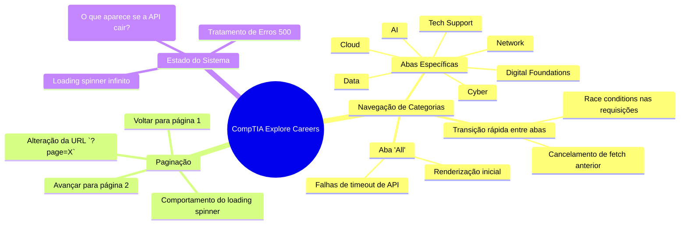

# 1. Mapa Mental Exploratório - CompTIA Explore Careers

Este mapa mental detalha a heurística de testes aplicada na página de Job Roles da CompTIA. O objetivo foi explorar os caminhos possíveis que o usuário poderia tomar e as integrações de API necessárias para renderizar o conteúdo.

