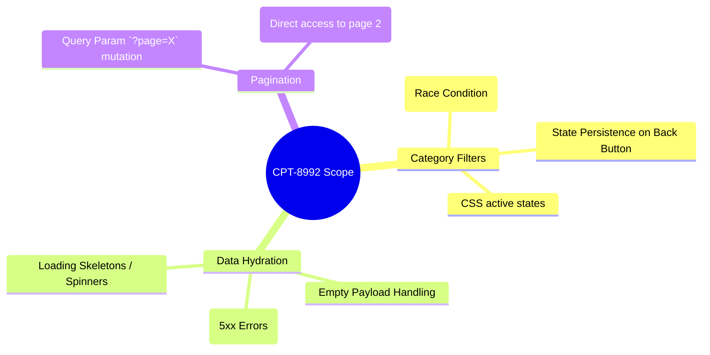

# SBTM: Exploratory Session Charter

**Session ID:** #402  
**Epic:** CPT-8992  
**Tester:** L. Tavares  
**Duration:** 90 mins (Test: 70% / Bug Reporting: 20% / Setup: 10%)  

## Charter Mission
*Explore the Job Roles filtering and pagination mechanisms to discover race conditions, API latency issues, and UI state inconsistencies.*

## Session Coverage (Mindmap)

## Session Notes
- **Observation:** Rapidly clicking between "Cloud" and "Cyber" triggers multiple fetch requests without cancellation (AbortController is missing).
- **Issue Discovered:** Accessing `?category=all` directly or via the UI button causes the loader component to hang indefinitely. Logged as `CPT-9045`.
