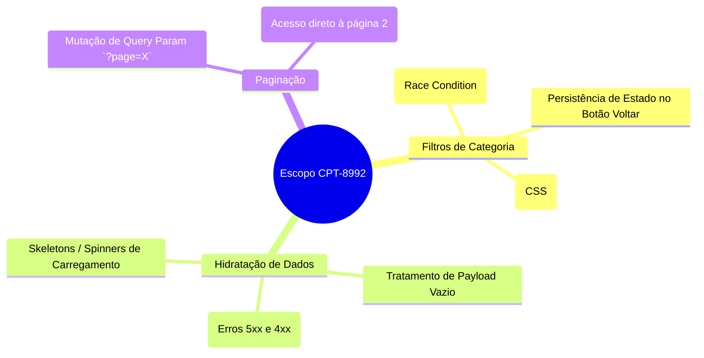

# SBTM: Charter de Sessão Exploratória

**ID da Sessão:** #402  
**Épico:** CPT-8992  
**Tester:** L. Tavares  
**Duração:** 90 mins (Teste: 70% / Reporte de Bug: 20% / Setup: 10%)  

## Missão do Charter
*Explorar os mecanismos de filtro e paginação de Carreiras (Job Roles) para descobrir possíveis race conditions, latência de API e inconsistências no estado da interface.*

## Cobertura da Sessão (Mindmap)

## Notas da Sessão
- **Observação:** O site utiliza chamadas Next.js RSC (React Server Components). O WAF pode estar configurado de forma excessivamente estrita para certas requisições.
- **Problema Descoberto:** Acessar a página com `?category=all` ou tentar alternar via UI causa um colapso contínuo na rede, onde as chamadas `_rsc` entram em aborto sistêmico (`net::ERR_ABORTED`), possivelmente causadas por conflitos de roteamento do cliente ou bloqueios prévios (403). Registrado como `CPT-9045`.
