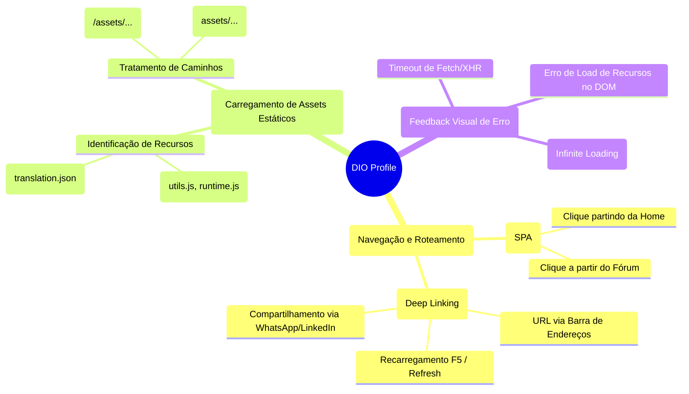

# Exploratory Testing Charter (SBTM) - DIO

**Session:** SPA Hydration & Asset Reliability
**Tester:** QA Engineer
**Duration:** 90 minutos (Uninterrupted)
**Mission:** Explorar o acesso ao Perfil Público da DIO simulando fluxos de roteamento direto (Deep Linking) via URL versus navegação interna (Client-Side), a fim de detectar falhas na hidratação de estado do React.

## Heurísticas e Mindmap Exploratório

Abaixo está o mapa mental estratégico utilizado durante a sessão de testes exploratórios baseados em risco:

## Notas da Sessão (Session Notes)

- **Áreas de Risco Elevado:** A arquitetura SPA depende de arquivos estáticos críticos sendo carregados no momento exato de inicialização (`document_start`). O erro no fornecimento das rotas dos assets via HTML principal é fatal para o React DOM.
- **Falha Crítica Encontrada durante a Exploração:** Ao acessar `web.dio.me/users/[nome_do_usuario]` pela barra de URL, o aplicativo entrava em um estado de "Loading Infinito" sem lançar exceções tradicionais no Console. 
- **Descoberta do Root Cause:** A análise avançada revelou um erro 404 de um arquivo auxiliar (`utils.js`). A plataforma utilizou caminhos relativos (sem a `/` no início). Logo, a requisição foi mapeada para `https://web.dio.me/users/assets/utils.js` em vez da rota absoluta (na raiz) `https://web.dio.me/assets/utils.js`. Essa falha de tag `<script>` foi a causa exata do "Infinite Spinner".
- **Decisão Técnica:** A automação E2E de regressão, no Playwright, deve interceptar requisições para caminhos incorretos de `assets` usando Expressões Regulares de Roteamento, forçando um Status 404 e validando se a tela se recupera ou trava infinitamente.