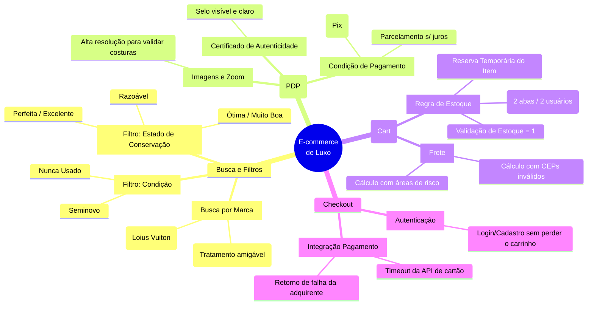

# 1. Mapa Mental de Testes Exploratórios

A automação de testes confirma que o sistema faz o que foi programado, mas são os **Testes Exploratórios** que garantem que o sistema faz o que o *usuário espera*. 

Para um e-commerce de luxo, o QA não deve apenas seguir roteiros felizes, mas atuar de forma investigativa. Abaixo, o mapeamento sistêmico focado nos módulos mais críticos de risco financeiro e de experiência.

## 🗺️ Heurística de Exploração (Fluxo Core)

O diagrama abaixo ilustra as ramificações de testes pensadas para a jornada do usuário, focando nos *pain points* (pontos de dor) específicos de artigos de luxo seminovos.

## 🔍 Foco da Análise Exploratória

1. **Responsividade (Mobile-First):** Pessoas comprando via smartphone precisam visualizar as tabelas de "Estado de Conservação" sem quebra de layout.
2. **Inconsistência de Dados:** Garantir que filtros não apresentem combinações impossíveis (Ex: Um item categorizado como "Nunca Usado" mas que na descrição acusa "Risco no couro").
3. **Tratamento de Mensagens de Erro:** Mensagens em fluxos críticos de pagamento devem ser claras e não expor falhas do servidor ao cliente final.
