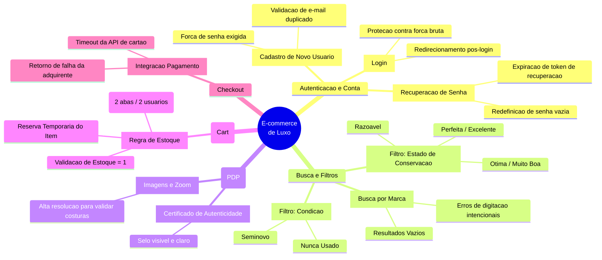

# 1. Mapa Mental de Testes Exploratórios

A automação de testes confirma que o sistema faz o que foi programado, mas são os **Testes Exploratórios** que garantem que o sistema faz o que o usuário espera. 

Para um e-commerce de luxo, o QA não deve apenas seguir roteiros felizes, mas atuar de forma investigativa. Abaixo, o mapeamento sistêmico focando nos módulos críticos de autenticação, risco financeiro e de experiência.

## Heurística de Exploração (Fluxo Core e Identidade)

O diagrama abaixo ilustra as ramificações de testes pensadas para a jornada do usuário, incluindo o fluxo fundamental de acesso e segurança da conta.

## Foco da Análise Exploratória

1. **Segurança de Autenticação:** Contas em e-commerces de alto ticket possuem cartões de crédito salvos e endereços nobres. Testes de segurança em recuperação de senhas e bloqueio de múltiplas tentativas de login são essenciais para evitar vazamento de dados.
2. **Responsividade (Mobile-First):** Pessoas comprando via smartphone precisam visualizar as tabelas de "Estado de Conservação" sem quebra de layout.
3. **Inconsistência de Dados:** Garantir que filtros não apresentem combinações impossíveis (Ex: Um item categorizado como "Nunca Usado" mas que na descrição acusa "Risco no couro").
4. **Tratamento de Mensagens de Erro:** Mensagens em fluxos críticos de pagamento e login devem ser claras e não expor falhas do servidor ao cliente final.
