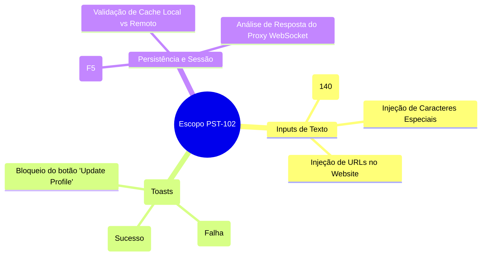

# SBTM: Charter de Sessão Exploratória

**ID da Sessão:** #88  
**Épico:** PST-102  
**Tester:** L. Tavares  
**Duração:** 45 mins (Teste: 60% / Reporte de Bug: 30% / Setup: 10%)  

## Missão do Charter
*Explorar as fronteiras de input no formulário de Perfil (Bio, Website) e monitorar a resposta do Backend (Proxy WebSocket) em relação ao Feedback da UI (Toasts).*

## Cobertura da Sessão (Mindmap)

## Notas da Sessão
- **Observação:** O fluxo de dados do Postman não usa REST puro para o perfil, e sim um tunelamento via `https://web.postman.co/_api/ws/proxy` com payloads mutantes.
- **Problema Descoberto:** A UI dispara a notificação "Updated your user profile" puramente baseada na resposta `{"result":"success"}` do Proxy. Contudo, ao dar F5 na página, os dados (Bio e Website) somem, indicando que o Backend mentiu sobre o sucesso ou há um problema de invalidação de Cache onde o GET inicial sempre traz um estado anterior vazio. Registrado como `PST-2044`.
