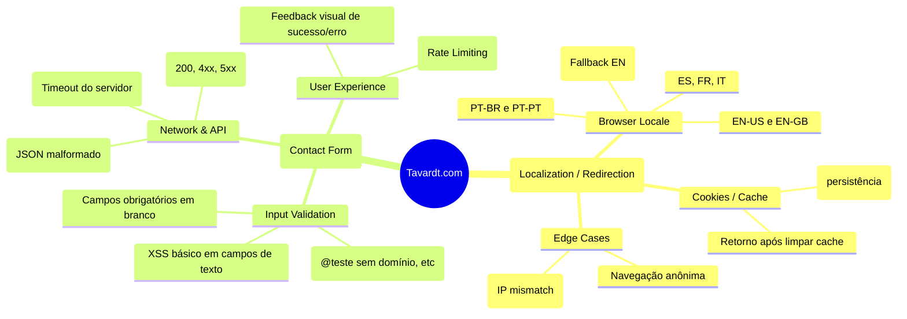

# Exploratory Testing Charter (SBTM) - TAVARDT

**Session:** Localization & Lead Capture Integrity
**Tester:** QA Engineer
**Duration:** 90 minutos (Uninterrupted)
**Mission:** Explorar o roteamento dinâmico de idiomas e o funil de contato, buscando falhas silenciosas que possam custar a perda de leads qualificados (B2B).

## Heurísticas e Mindmap Exploratório

Abaixo está o mapa mental estratégico utilizado durante a sessão de testes exploratórios baseados em risco:

## Notas da Sessão (Session Notes)

- **Áreas de Risco Elevado:** O redirecionamento de idiomas ocorre na montagem inicial do lado do cliente (Client-side rendering). Um erro no parsing do cabeçalho `Accept-Language` ou `navigator.language` resulta numa página em branco ou na língua errada, causando rejeição imediata do lead internacional.
- **Falha de UX Encontrada durante a Exploração:** Tentar enviar o formulário com a rede instável não apresentou um *spinner* de loading claro nas primeiras iterações (posteriormente mapeado para automação).
- **Decisão Técnica:** A validação do formulário deve focar não apenas na UI vermelha/verde, mas na escuta do Web Traffic (`api/contact`) para garantir que o *backend* validou a requisição.
